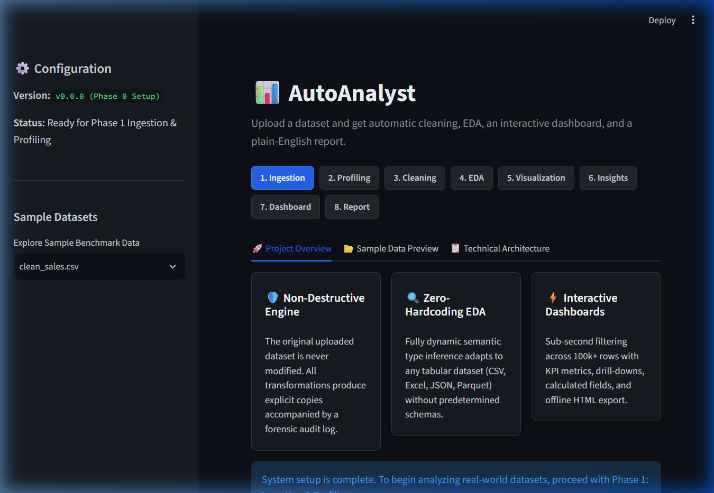
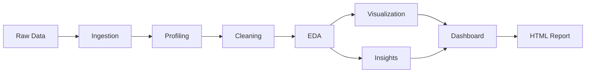

# AutoAnalyst 📊

[](https://www.python.org/)
[](https://opensource.org/licenses/MIT)
[](tests/)

> Turn raw datasets into publication-ready dashboards, statistical audits, and plain-English business insights in seconds — with zero coding required.

AutoAnalyst is a local, privacy-first automated data analyst built with Python and Streamlit. Upload a CSV, Excel, or JSON dataset, and AutoAnalyst autonomously profiles data health, cleans defects while maintaining a forensic audit log, runs comprehensive exploratory data analysis (EDA), generates interactive Power BI / Tableau-grade dashboards, surfaces plain-English insights, and exports standalone reports.

---

## 🌟 Key Features

- **Multi-Format Ingestion**: Auto-detects encoding (chardet), delimiters, header rows, and multi-sheet workbooks for CSV, Excel, JSON, and Parquet files up to 200 MB.
- **Dynamic Semantic Profiling**: Automatic inference of numeric, categorical, datetime, text, boolean, ID-like, and constant columns without hardcoded column names.
- **Objective Quality Score**: Transparent 0–100 data quality scoring based on completeness, uniqueness, type consistency, and validity.
- **Self-Auditing Cleaning Engine**: Transparently imputes missing values, handles outliers (IQR/Z-score), parses mixed date/currency formats, and standardizes text variants — recording every row change to an exportable log.
- **Automated Exploratory Data Analysis (EDA)**: Computes skewness, kurtosis, normality tests, correlation matrices (Pearson/Spearman), ANOVA/t-tests, and time-series decomposition.
- **Interactive Visualization**: Generates colorblind-safe, publication-grade Plotly charts (histograms, box plots, scatter trendlines, heatmaps, and category breakdowns).
- **Executive Insights Engine**: Surfaces prioritized, rule-based business observations backed by verified numerical figures.
- **Power BI / Tableau-Style Dashboard**: Global multi-dimensional filters with sub-second response times on 100k+ rows, KPI summary cards, drill-downs, calculated fields, and offline HTML export.
- **One-Click Executive Reports**: Export comprehensive HTML summary reports and cleaned datasets.

---

## 🖥️ Application Preview



---

## 🏗️ Architecture & Pipeline



AutoAnalyst operates under strict non-negotiable principles:
1. **The original DataFrame is never modified.** All transformations occur on explicit copies.
2. **Every cleaning action is recorded in a structured audit log.**
3. **All figures shown to the user are computed directly in code.**

---

## 🛠️ Tech Stack

- **Core & UI**: Python 3.10+, [Streamlit](https://streamlit.io/)
- **Data Manipulation**: [pandas](https://pandas.pydata.org/), [NumPy](https://numpy.org/)
- **Statistics & Modeling**: [SciPy](https://scipy.org/), [statsmodels](https://www.statsmodels.org/), [scikit-learn](https://scikit-learn.org/)
- **Interactive Visualizations**: [Plotly](https://plotly.com/python/)
- **File Parsing**: `openpyxl` (Excel), `pyarrow` (Parquet), `chardet` (Encoding detection)
- **Reporting**: [Jinja2](https://palletsprojects.com/p/jinja/)
- **Quality Assurance**: `pytest`, `flake8`, `black`

---

## 🚀 Getting Started

### 1. Clone the Repository
```bash
git clone https://github.com/BhuvanJJ0055/Auto_analyst.git
cd Auto_analyst
```

### 2. Create and Activate a Virtual Environment
```bash
# On Windows
python -m venv .venv
.venv\Scripts\activate

# On macOS/Linux
python3 -m venv .venv
source .venv/bin/activate
```

### 3. Install Dependencies
```bash
pip install -r requirements.txt
```

### 4. Generate Benchmark Datasets
```bash
python scripts/make_sample_data.py
```

### 5. Launch AutoAnalyst
```bash
streamlit run app.py
```
Open your browser at `http://localhost:8501`.

---

## 🧪 Running Tests

Run the complete test suite with `pytest`:
```bash
pytest -v
```

To run style and code formatting checks:
```bash
flake8 modules tests app.py
black --check modules tests app.py
```

---

## 📁 Sample Datasets

Synthetic benchmark datasets are automatically generated into `sample_data/` by `scripts/make_sample_data.py`:
- `clean_sales.csv`: 1,000 pristine transaction rows with zero data defects.
- `messy_sales.csv`: 5,000 transaction rows with deliberate defects (140 duplicate rows, 5-15% null values across 3 columns, currency symbols, mixed date formats, outliers, negative ages, future dates, constant column, all-null column).
- `timeseries_sales.csv`: 3 years of daily transaction volume exhibiting growth trend and seasonal cycles.
- `tiny.csv`: 50 rows for smoke and edge-case testing.
- `sales.xlsx` & `sales.json`: Multi-format representations for ingestion validation.
- `large.csv`: 200,000 rows for high-volume performance benchmarking (git-ignored).

---

## ⚠️ Current Limitations

- AutoAnalyst executes entirely in-memory; datasets larger than physical RAM should be sampled prior to upload.
- PDF export requires system-level WeasyPrint libraries; HTML export is supported natively across all operating systems.

---

## 🔮 Roadmap & Future Improvements

- Automated forecasting models (Prophet / ARIMA)
- Direct database connectors (PostgreSQL, Snowflake, BigQuery)
- Automated natural language Q&A over schema and aggregated subsets

---

## 📄 License

This project is licensed under the MIT License - see the [LICENSE](LICENSE) file for details.
