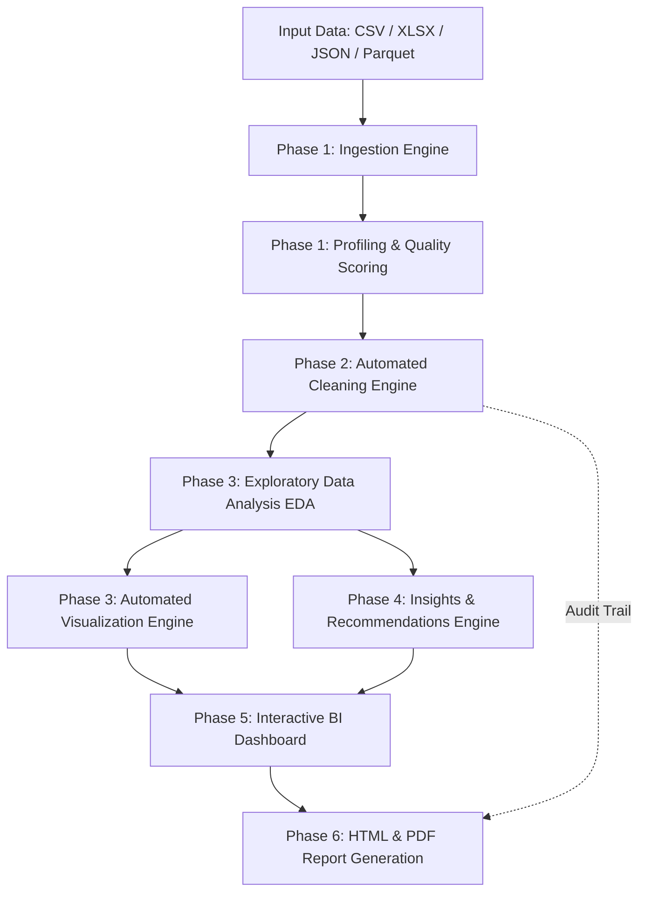

# AutoAnalyst Architecture & Pipeline Design

AutoAnalyst is an autonomous, non-destructive data analytics application designed to convert raw datasets (CSV, Excel, JSON, Parquet) into actionable business intelligence.

## Pipeline Flow

## Core Design Principles

1. **Non-Destructive Guarantee**: The original uploaded dataset is never modified in place. All transformations yield immutable copies.
2. **Comprehensive Audit Trail**: Every data cleaning step is recorded with the exact rule, column, rows affected, and before/after distribution.
3. **Zero-Hardcoding**: Dynamic type inference ensures compatibility with arbitrary tabular structures.
4. **Local Execution**: No mandatory external cloud services or databases; completely privacy-preserving.
